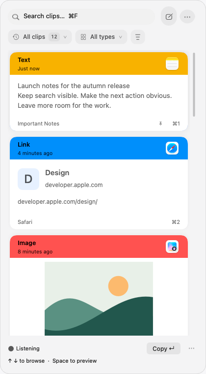
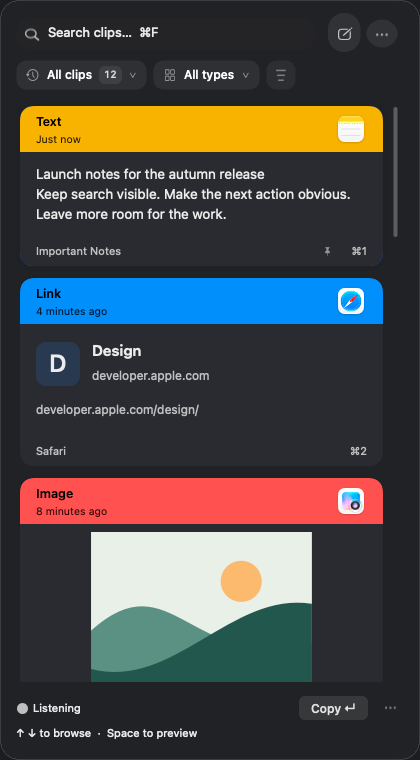
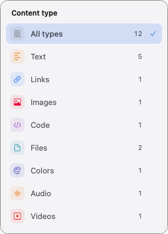
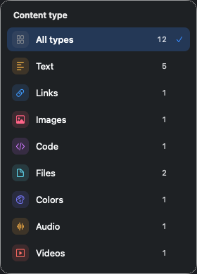
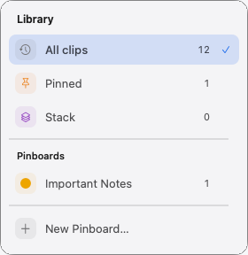
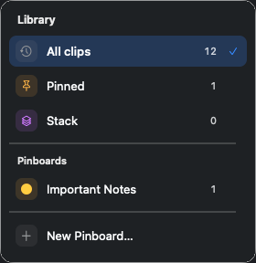
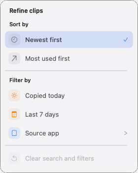
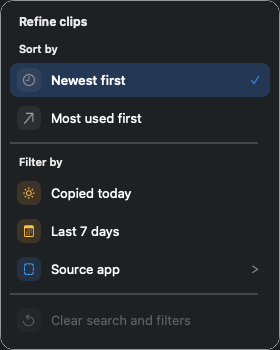

# Goldfish interaction refinement · September 22, 2026

Native AppKit renders with synthetic clips and isolated preferences. These images show appearance, not animation timing. The production app keeps the vertical shelf.

## Shelf

| Light | Dark |
| --- | --- |
|  |  |

## Category menu

| Light | Dark |
| --- | --- |
|  |  |

## Library

| Light | Dark |
| --- | --- |
|  |  |

## Filters and sorting

| Light | Dark |
| --- | --- |
|  |  |

[Compact](shelf-compact-light.png), [wide](shelf-wide-light.png), and [larger text](shelf-large-text-light.png) variants are included in both appearances.
