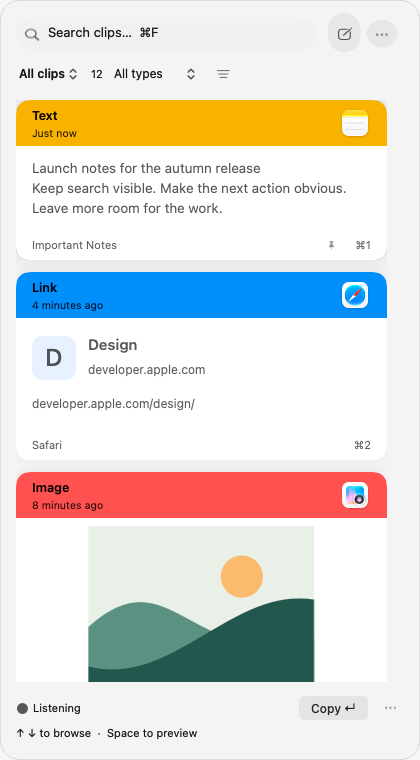
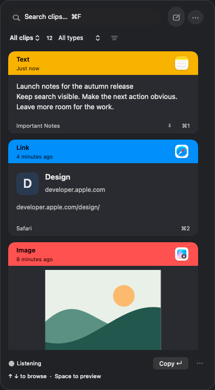
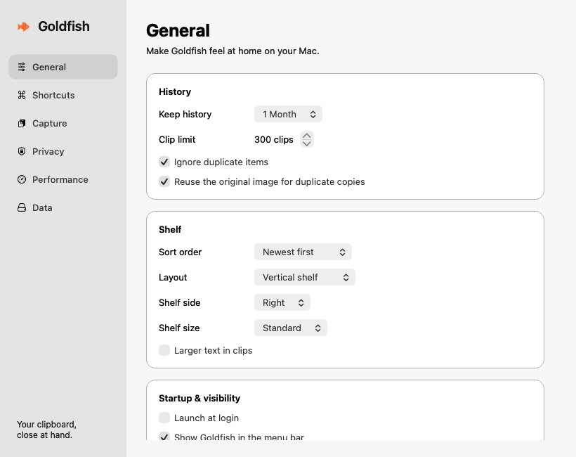

# Goldfish design and workflow rebuild · September 22, 2026

> Historical record. Counts, screenshots, and implementation details describe that pass. Current guidance is in [the documentation index](../README.md); source links refer to current files and have no historical line guarantees.

Goldfish keeps its vertical shelf, vertical destination menu, and one column of cards. The design now centers on recognizing the copied object before selecting it. iOS is out of scope. The Goldfish name and existing history, storage, bundle, and keychain compatibility are preserved.

## Design basis

Studied the [Paste website](https://pasteapp.io/), [use cases](https://pasteapp.io/use-cases), [release history](https://pasteapp.io/updates), [Paste 6 design article](https://pasteapp.io/blog/paste-in-liquid-glass), [Power Search](https://pasteapp.io/blog/paste-power-search), and [Mac window article](https://pasteapp.io/blog/paste-4-0-your-workflow-amplified-once-again), including their original product images. The transferable principles are visible content, stable geometry, restrained controls, strong alignment, useful provenance, and native interaction. Third-party promotional artwork is not shipped with Goldfish.

## Cards and navigation

- Every card exposes its content before selection. Layout sizes, hit targets, and scroll positions remain stable. Hover now brings a card forward with a short spring, slight magnification, and a deeper shadow; its immediate neighbors gently recede. Keyboard navigation and scrolling clear the effect. Reduce Motion keeps the cards still.
- Headers identify type and age, with the actual source app icon where available. Text uses readable paragraphs; code preserves indentation and uses restrained syntax coloring. Images and document thumbnails occupy a substantial part of the card. Colors show their actual value and alpha.
- Link cards show a recognizable destination and readable address. A single URL copied as plain or rich text participates in Link filtering and previews without changing its original paste representation. Background browsing is not required for card rendering; Space opens a requested web preview.
- Files prefer their original names. Internal UUID filenames and managed storage paths use honest fallbacks. Missing media previews are explicit. Footers avoid repeating the body’s filename or character counts.
- Short copies remain compact. Native TextKit measures and paints the same text so larger text does not truncate an otherwise readable paragraph. Long text is bounded. Widths remain 336, 420, and 540 pt, with 16 pt outer padding, 12 pt card gaps, and 13 pt continuous card corners.
- Search, New Clip, and More form the top toolbar. The next row uses rounded Library and Content type buttons with a quiet filter button. Clip counts sit inside the Library button. The grouped menus use colored symbols, rounded selection states, counts, and consistent row spacing. Sorting lives in the filter menu. Active filters show their scope and a clear reset action.
- Category counts reflect the current Pinboard and search, independently of the selected content type. Source and date choices replace their previous filter while preserving other query terms. Menu keyboard navigation, type-ahead, Return, and Escape are supported, including real arrow-key event flags. Menus belong to the shelf and close with it.
- Scrollbars keep native dragging, paging, and accessibility, with a 4 pt rounded thumb that widens to 6 pt on interaction. The contrasting track is removed. macOS controls overlay fading and the Always Show Scroll Bars preference remains supported. Four points of clearance around cards accommodate hover magnification.
- Down/Up from search enters the selected result; subsequent arrows browse and Space previews. Search focus follows the whole capsule. Keyboard shortcuts, context menus, multi-selection, Pinboards, and drag-out remain available.
- Standard Close, Undo/Redo, Cut, Copy, Paste, and Select All commands follow the native responder chain. Search retains its own text-editing commands instead of treating Copy, Undo, or Command-arrow as clip actions. Command-W also dismisses the shelf.
- Captures reuse unchanged cards and retain the visible clip and its scroll offset. Hidden new copies get a Show new recovery action. Action feedback and Undo survive capture notifications. Quiet capture details are available from Listening; paused and error states remain visible.

## Window and flow behavior

| Action | Result |
| --- | --- |
| Open with the shortcut or menu-bar toggle | A nonactivating shelf takes keyboard focus while retaining the destination app. |
| Open/close animation | A short 18 pt translation and fade; Reduce Motion removes the transition. |
| Place the shelf | A 12 pt margin inside the usable display, respecting the Dock and display offsets. |
| Open a preview | A child panel beside the shelf when space permits. The shelf stays open. Media does not autoplay. |
| Close a preview or press Escape | Return to the selected card with the search and scope preserved; web media and page timers stop. |
| Click outside | Dismiss the shelf and its previews together. |
| Escape in search | Clear the query first; a subsequent Escape closes the shelf. |
| Open Settings | Dismiss the shelf before showing the stable Settings window. |
| Open Settings during an attached edit | Keep the editor and its draft in front until Save or Cancel. |
| Create/edit text or a Pinboard | An attached sheet, validation before saving, and the original intended clip IDs retained. |
| Copy without Accessibility permission | Copy the value and show an explicit Command-V instruction. |
| Export/import | A cancellable sheet attached to Settings; export names receive one archive extension. |
| Destructive cleanup | An attached confirmation with Cancel focused, Escape cancellation, and no destructive default Return action. |

Preview ownership follows native [AppKit child-window behavior](https://developer.apple.com/documentation/appkit/nswindow) and [embedded Quick Look](https://developer.apple.com/documentation/quicklookui/qlpreviewview). Opening the shelf does not activate Goldfish over the current app. The menu-bar mouse-down toggle and status-item dismissal guard remain in place, including interrupted opening/closing animations.

## Supporting screens

Settings keeps a stable, resizable sidebar window across General, Shortcuts, Capture, Privacy, Performance, and Data. Long pages scroll rather than resize the window. Forms use native controls, aligned labels, grouped surfaces, concise explanations, and explicit operation outcomes. Shortcut recording cancels without changing a binding. Archive/import and cleanup dialogs belong to Settings.

The welcome screen previews the same vertical card language. Only Start completes setup and enables future capture; closing it defers setup. Text editors fit the shelf width and keep consistent padding. Empty history, empty Pinboards, no matches, paused capture, hidden captures, and unavailable media provide relevant recovery actions.

## Visual evidence

These native AppKit fixtures use synthetic content and isolated preferences, without customer history.

[All current fixtures](goldfish-design-2026-09-22/README.md) include light/dark appearances, three widths, larger text, focus/multi-selection, content types, document fallbacks, editor/Pinboard sheets, capture/filter recovery, every Settings section, and onboarding. The September 21 fixtures are historical.

[Latest interaction refinement](goldfish-interactions-2026-09-22/README.md) supersedes the shelf/navigation appearance above and shows the category, Library, and filtering menus in light and dark. The direction takes cues from the quiet controls, depth, and rounded shapes in [Paste’s current Mac design](https://pasteapp.io/blog/paste-in-liquid-glass), adapted to the vertical layout. The motion is Goldfish’s implementation, not a measured reproduction of Paste’s animation.

## Verification scope

The full suite passes **332 tests**. The production app is packaged as `build/Goldfish.app`, with a verified hardened-runtime ad-hoc signature and passing executable/bundle size gates. Shell syntax and `git diff --check` pass.

Automated coverage includes card geometry and text fitting, consistent Link classification, original file identity, card reuse, viewport preservation, search-to-result focus, preview ownership and closure, editor preservation, Settings geometry, safe cleanup cancellation, capture, paste fallback, persistence, encryption, and archive compatibility. See [SMOKE_TEST.md](../SMOKE_TEST.md) for the release checklist.

Live checks on this Mac confirmed capture of a harmless TextEdit sample, keyboard search, Down-to-result focus, Space preview, Escape returning to the same result and search, Copy feedback, intact paste back into TextEdit, Settings opening from the shelf, all six Settings sections, shortcut cancellation, and archive export cancellation. The final export sheet displayed exactly one archive extension and returned to Settings on Cancel. Escape also dismissed the history-cleanup confirmation without deleting anything. Command-W closed Settings in the final packaged app. The live pass found and drove fixes for search focus, editor padding, duplicated export extensions, and the missing standard Close command.

This Mac currently has no Accessibility permission for Goldfish, so the live paste check exercised Copy followed by Command-V. Automatic paste has automated coverage but was not permission-enabled during this pass. Quick Look content and closure were verified through native accessibility; its screenshot failed in ScreenCaptureKit. The UI connection recovered after an intermittent failure. The final editor’s blank state and validation were visible; padding and both appearances were also verified in the isolated renders. Physical menu-bar clicks, VoiceOver, multiple displays/Spaces, older macOS versions, and comparative frame pacing remain release checks. No 2027 certification or measured parity with Paste’s runtime performance is claimed.
